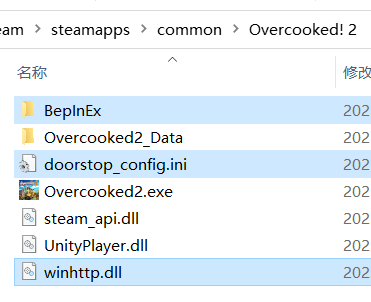
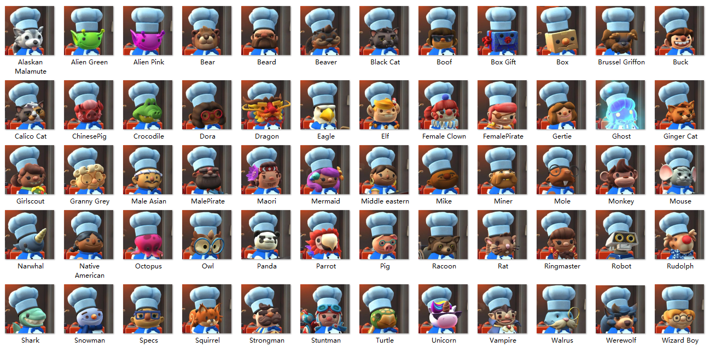
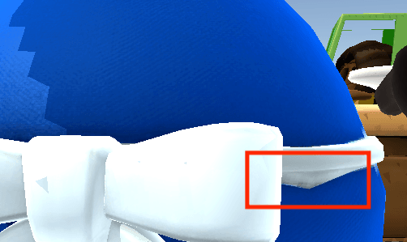

# 厨房暖暖 快速载入 / DIYChef FastInit

[English](README.md)

**当前版本：2.2.0.14（测试版）**

本项目基于 [gua248 的 Overcooked2-DIYChef](https://github.com/gua248/Overcooked2-DIYChef)（《胡闹厨房 2》厨师外观模组，厨房暖暖），优化额外厨师和帽子的加载流程，减少安装大量资源时的启动等待，并加快已缓存资源的再次载入。原有厨师资源、`prefer.txt` 和 BepInEx 配置可以继续使用。

## 优化内容

- **按需加载**：启动时登记资源信息，实际使用厨师或帽子时再加载模型与纹理。
- **内存复用**：缓存最近使用的资源，按预算回收闲置资源，减少重复创建。
- **磁盘缓存**：保存处理后的网格和纹理，重启游戏或资源被内存缓存回收后也能复用；源文件变化时自动重建。
- **无损纹理压缩**：使用 LZ4HC 在后台压缩纹理缓存，保持像素、画质和 mipmap 不变，减少缓存占用。
- **ModelTest 粒子兼容**：切换厨师后自动补挂粒子特效；无需修改 ModelTest DLL，未安装时不启用。
- **自定义默认厨师**：允许将自定义厨师排在首位，进入游戏或添加本地玩家时自动选用；联机替代外观单独选择。此功能未经游戏内测试，联机表现尚未验证。
- **厨师网格选择**：固定 10 列 × 5 行，按行滚动；方向移动时让选中框保持在第 2–4 行，到列表首尾后停止。按本地玩家顺序逐个确认，只有当前玩家可以操作。支持单击选择、双击厨师确认，确认／返回提示跟随当前玩家的键盘或 Xbox／PS／Switch 设备及实际按键映射。Esc／B 取消时保留玩家，滚动条支持鼠标拖动及点击轨道，已移除上移／下移按钮。未选中头像默认压暗 40%，比例可配置，右侧保留名称及独立 512 像素预览。沿用现有头像缓存。操作、配置和设备识别限制见 [厨师网格说明](docs/CHEF_GRID.md)。实际输入和画面效果尚待游戏内复测。

## 安装与升级

当前版本按 Windows Steam x86 环境构建和验证，需要安装 BepInEx 5 x86。

退出游戏后，将原插件 DLL 备份到 `BepInEx/plugins` 目录之外，再把 **`DIYChefFastInit.dll`** 放入原插件目录，保留旁边的 `Resources`、`prefer.txt` 等文件。插件 ID 和配置文件名保持不变。

磁盘缓存保存在 **`BepInEx/cache/DIYChefFastInit`**。首次使用仍需生成缓存，后续载入可复用；删除缓存后会自动重新生成。原始厨师资源仍需保留。

构建方法、缓存配置和诊断方式见 [加载与构建说明](docs/LOADING.md)，第三方组件见 [第三方声明](docs/THIRD_PARTY_NOTICES.md)。

---

# 胡闹厨房2 - 厨师外观模组

## 安装

1. 为 Windows Steam x86 版游戏安装 BepInEx 5 x86：

   Steam 端安装 x86 版本（[GitHub](https://github.com/BepInEx/BepInEx/releases) 或 [百度网盘链接](https://pan.baidu.com/s/1G81rpJNwVsJplJi6fD2jPA?pwd=lobe)）

   解压后拷贝到游戏根目录下（下图中选中的三项）

   

2. 从本仓库的 [Releases](../../releases) 下载 `DIYChefFastInit.dll`，在游戏目录下创建 `BepInEx/plugins/OC2DIYChef` 文件夹，将 DLL 放入其中。升级时，将旧的 `OC2DIYChef.dll` 或 `DIYChefFastInit.dll` 备份到 `BepInEx/plugins` 目录之外，再安装新 DLL，保留原有的 `Resources` 和 `prefer.txt`。

> ### 编译
>
> 安装 .NET SDK，先运行 `./tools/Fetch-Lz4.ps1`，再运行 `dotnet build -c Release "-p:GameDir=<游戏安装目录>"`。项目直接引用游戏的 Managed 和 BepInEx 程序集，生成 `bin/Release/DIYChefFastInit.dll`。
>
> 当前构建面向 Steam x86 版游戏，目标框架为 .NET Framework 3.5。配置、缓存与验证方式见 [加载与构建说明](docs/LOADING.md)。

## 使用

### 隐藏部分厨师

- 将 `OC2DIYChef/official-all.txt` 原地复制一份并重命名为 `prefer.txt`，然后编辑 `prefer.txt`，删去不想使用的厨师的名字。厨师名对应见下图。

  

  
由糯米糍整理

  
- 可以在 `prefer.txt` 中对厨师排序，其中第一个有效且可用的厨师是默认厨师，可以是额外厨师。每次进入游戏或添加本地玩家时会自动选用默认厨师。
- 联机时，无法显示你所选额外厨师的玩家会看到 `prefer.txt` 中第一个已解锁的官方厨师；如果列表没有可用的官方厨师，会弹出“默认厨师不可用”，并使用 `Chef_Snowman` 作为联机替代外观。

- 此 MOD 不会修改厨师的解锁状态，包括需要通过关卡或 DLC 解锁的厨师。

- 其他玩家仍会正常显示其选择的厨师，即使你隐藏了该厨师。

### 添加额外厨师

- 将厨师资源文件夹拷贝到 `OC2DIYChef/Resources` 文件夹中，并将厨师资源文件夹名添加到 `prefer.txt` 中即可。
- 在资源文件夹中但未添加到 `prefer.txt` 的额外厨师不会被加载。
- 额外厨师可以作为默认厨师，将其放在 `prefer.txt` 的首位即可。纯额外厨师列表不会因为联机替代外观而自动加入雪人供切换。
- 额外厨师的联机互相显示规则为：当主机安装了此 MOD 且两个玩家都添加了某一个额外厨师时，互相显示该额外厨师；否则显示上述官方联机替代外观。
- 部分三代厨师资源：[链接](https://pan.baidu.com/s/1EWneQ8k8-P0v49UKs5UpRg?pwd=iu9i)。

### 替换帽子

在 `prefer.txt` 的每个厨师后面可以（用空格隔开）添加 `HAT=xxx` 用来指定该厨师的帽子样式，可选的有 `None`（不戴）, `Santa`（圣诞）, `Fancy`（厨师帽）, `Baseballcap`（篝火）。

### 添加额外帽子

- 将帽子资源文件夹拷贝到 `OC2DIYChef/Resources/HATS` 文件夹中即可，帽子名为帽子资源文件夹名。

### 街机大厅换厨师

在街机大厅选图或匹配时，点击右上角的“切换厨师”，或按 F2，调出相同的厨师网格。手柄也可使用按钮旁显示的快捷键（原版多人菜单键，完整 Xbox 手柄默认 Y）；提示随设备及分屏映射变化。依次确认本地玩家后返回大厅，返回键会还原进入网格前的厨师。默认启用，不需要修改 `prefer.txt`；`[ChefSelection] GridEnabled=false` 会一起关闭网格及大厅入口。

原有的上下键切换仍可通过 `prefer.txt` 中的 `LOBBYSWITCHCHEF=TRUE` 开启；网格打开时暂停该快捷操作。街机入口的实际位置、鼠标及手柄操作和联机显示尚待游戏内复测。

### 提示消息

- 默认厨师不可用：`prefer.txt` 第一行的厨师必须是已解锁的非额外厨师，否则将设置 Male_Asian 为默认厨师。
- 缺失 INFO 文件：每个额外厨师资源文件夹中必须包含名为 `INFO` 的信息文件。
- 缺失主贴图：每个额外厨师资源文件夹中必须包含名为 `t_Head.png` 的主贴图文件和名为 `m_Head.txt` 的主材质文件。
- ID 冲突：两个额外厨师的 ID 冲突，或 `INFO` 文件中缺少 ID 值定义。

## 自制厨师指南

- 你可以自制厨师外观。每个自制厨师包括其模型、贴图和材质。

- 参考示例资源格式，你至少需要提供：

  - 头部模型 `Head.obj`，主贴图 `t_Head.png` 以及主材质 `m_Head.txt`；
  - 手部张开和抓握模型 `Hand_{Grip/Open}_{L/R}.obj`；
  - `INFO` 文件，其中包含值 `ID=xxx`。额外厨师的 ID 是一个 0 ~ 254 的整数，用作联机消息传递。ID 值 0 ~ 63 预留给三代厨师资源，请选择从 64 开始的值，且最好避开已发布的额外厨师的 ID 值。

  此外还可以提供：

  - 尾巴模型 `Tail.obj`；

  - 固定在头部的部件模型 `Head{1/2}.obj`；

  - 眼部模型 `Eyes.obj`（睁眼），`Eyes2_Blinks.obj`（闭眼），`Eyebrows.obj`（眉毛）；

  - 身体各部分模型 `Body_Body.obj`, `Body_Top.obj`, `Body_NeckTie.obj`, `Body_Tail.obj`, `Body_Bottom.obj`，以及身体贴图和材质 `t_Body.png`, `m_Body.txt`；

    > - Body_Body 会根据顶点高度按不同权重绑定骨骼，动画效果类似弹簧；其余身体部分绑定单个骨骼。
    > - 身体贴图中全透明的部分会替换为厨师颜色（蓝 / 红 / 绿 / 黄）。
    > - 当且仅当提供 Body_Body 时会删除原本的身体。有需要时你可以提供一个空的 Body_Body。
    > - Tail 在厨师背上背包时会隐藏，Body_Tail 不会。
    > - 所有 Body_xxx 在厨师进入大炮时会隐藏。

  - 载具模型 `Wheelchair.obj`；

  - 刀模型 `Knife.obj`；

  - 各模型的单独贴图 / 材质文件（文件名前缀 `t_` / `m_`，无单独贴图 / 材质的模型使用主贴图 / 材质）；

    > - 例如 Body_Top 会依次尝试寻找贴图文件 t_Body_Top，t_Body，t_Head。
    >
    > - 材质参数说明：
    >   `_Brightness_Intensity`：身体部分可用，总光照强度；
    >   `_Metallic`：金属度；
    >   `_RimIntensity`：边缘光强度；
    >   `_RimPower`：边缘光衰减；
    >   `_Roughness`：平滑度，值越大代表越平滑。

  - `INFO` 文件中可以添加 `BODY=xxx` 来使用不同的身体模型，例如 `BODY=Chef_Snowman`。

- 你可以自制帽子。需要提供帽子模型、贴图和材质 `HatName.obj`, `t_HatName.png`, `m_HatName.txt`，放在文件夹 `HatName` 中。不要使用以下帽子名：`None, Santa, Festive, Baseballcap, Baseball, Fancy`。

  

## 更新

#### v2.2.0

**测试状态：新增的自定义默认厨师功能未经游戏内测试，联机表现尚未验证。**

- 允许额外厨师作为默认厨师，启动和添加本地玩家时同步设置额外厨师 ID。
- 联机替代外观取 `prefer.txt` 中第一个已解锁的官方厨师；没有可用的官方厨师时提示“默认厨师不可用”，并使用 `Chef_Snowman`。

#### v2.1.0

- 自动补挂 ModelTest 粒子特效，覆盖首次载入和切换回已缓存厨师。
- 检测插件 ID 中的 `modeltest` 字符串，忽略大小写；接口不兼容时停用补挂并提示一次。
- 修复厨师实例销毁时误回收外部共享粒子材质的问题，保留预制体及其他厨师仍在使用的材质。
- 无需修改 ModelTest DLL，可继续沿用现有资源、配置和缓存。

#### v2.0.0

- 按需加载额外厨师，使用有预算限制的内存缓存及持久化网格、纹理缓存。
- 在后台使用 LZ4HC 无损压缩纹理缓存。
- 插件构建产物改为 `DIYChefFastInit.dll`，沿用原有插件 ID、资源目录结构和配置。

#### v1.3

- 支持 Steam Beta 版和 Epic 版。

#### v1.2

- 支持替换刀模型。
- 修复了默认厨师使用自制帽子时第一次不显示的 bug。
- 降低了关卡结算界面的光照。
- 修复了 Body_Body 加载过慢的问题。

#### v1.1

- 支持自制厨师身体等更多部分。

- 支持自制帽子，支持在 UI 界面使用各种帽子。

- 增加模型加载进度显示。

- 修复了厨师被车撞后的淡出效果。

- 修复了原始厨师模型上的一个顶点权重错误。

  

- 兼容配置文件名 `prefer.txt.txt`。
