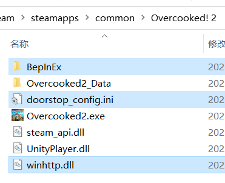
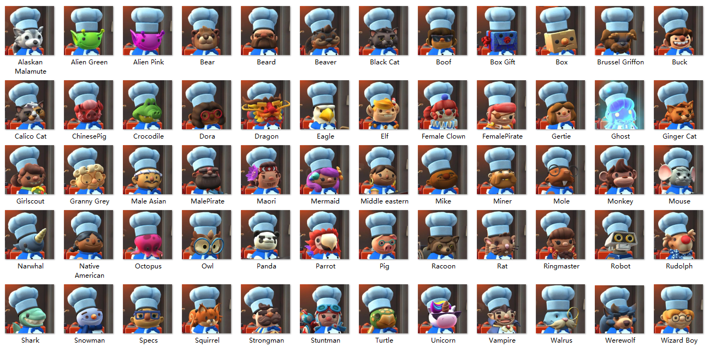
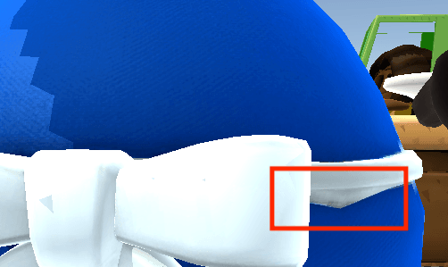

# DIYChef FastInit

[中文说明](README-zh.md)

**Current version: 2.2.0.23 (test build)**

This project builds on [Overcooked2-DIYChef by gua248](https://github.com/gua248/Overcooked2-DIYChef) to reduce startup waits when many custom chefs and hats are installed, and to speed up loading previously cached resources. Existing chef resources, `prefer.txt` and BepInEx configuration remain compatible.

## Improvements

- **Load on demand:** Register resource information at startup, then load models and textures when a chef or hat is used.
- **Reuse resources in memory:** Cache recently used resources and reclaim idle entries according to the cache budget.
- **Persistent disk cache:** Reuse processed meshes and textures after a game restart or memory cache eviction. Changed source files automatically rebuild their cache entries.
- **Lossless texture compression:** Compress texture caches with LZ4HC in the background, reducing disk usage while preserving pixels, image quality and mipmaps.
- **ModelTest particle compatibility:** Reapply particle effects after chef replacement without modifying the ModelTest DLL. The bridge stays inactive when ModelTest is absent.
- **Custom default chefs:** Put a custom chef first to select it automatically when entering the game or adding a local player. The official online fallback is selected separately. This feature has not been tested in-game, and online behavior has not been verified.
- **Chef selection panels:** Up to four local players select simultaneously in one horizontal row. Each panel has its own five-row grid above a centered preview/info group, with confirmation at bottom right. Thumbnails have small gaps and a player-coloured selection background; a single player sees 15 columns. Hover selects; one click confirms. Confirm again to edit only that player's choice. Only P1 can cancel using the bottom-left back action. Device prompts follow actual bindings. Grey portrait caches are shared; dimming is configurable. See the [usage guide](docs/CHEF_GRID.md) (Chinese). Actual input and appearance need in-game verification.

## Installation and upgrades

The current version is built and verified for the Windows Steam x86 game and requires BepInEx 5 x86.

Exit the game, back up the old plugin DLL outside `BepInEx/plugins`, and place **`DIYChefFastInit.dll`** in the existing plugin directory. Keep `Resources`, `prefer.txt` and other resource files alongside it. The plugin ID and configuration filename remain unchanged.

Disk caches are stored in **`BepInEx/cache/DIYChefFastInit`**. The first use still needs to generate cache entries; subsequent loads can reuse them. Deleted caches are generated again automatically. Keep the original chef resources installed.

See the [loading and build guide](docs/LOADING.md) for build instructions, cache settings and diagnostics, and the [third-party notices](docs/THIRD_PARTY_NOTICES.md) for component details. Both documents are in Chinese.

---

# Overcooked! 2 - DIY Chef MOD

## Installation

1. Install BepInEx 5 x86 for the Windows Steam x86 game:

   Download the x86 release from [GitHub](https://github.com/BepInEx/BepInEx/releases) or [Baidu Netdisk](https://pan.baidu.com/s/1G81rpJNwVsJplJi6fD2jPA?pwd=lobe).

   Extract the archive and copy its contents into the game directory (the three selected items below).

   

2. Download `DIYChefFastInit.dll` from this repository's [Releases](../../releases), create a folder `BepInEx/plugins/OC2DIYChef` in the game's directory and copy the DLL into it. When upgrading, back up the previous `OC2DIYChef.dll` or `DIYChefFastInit.dll` outside `BepInEx/plugins`, then install the new DLL alongside the existing `Resources` and `prefer.txt`.

> ### Compiling
>
> Install the .NET SDK, run `./tools/Fetch-Lz4.ps1`, then `dotnet build -c Release "-p:GameDir=<game directory>"`. The build references the game's Managed and BepInEx assemblies directly and produces `bin/Release/DIYChefFastInit.dll`.
>
> The current build targets the Steam x86 game with .NET Framework 3.5. See [loading and build documentation](docs/LOADING.md) for configuration, caching and verification.

## How to use

### Hiding some of the chefs

- Copy `OC2DIYChef/official-all.txt` to `OC2DIYChef/prefer.txt`, then edit it and remove the names of the chefs you don't want to use. The names of all the chefs are shown below.

  

  
Compiled by 糯米糍

  
- You can sort the chefs in `prefer.txt`. 

  The first valid, available chef is the default chef and can be a DIY chef. It is automatically chosen when entering the game or adding a local player.

- Online players who cannot display your DIY chef see the first unlocked official chef in `prefer.txt`. If the list has no available official chef, the mod shows "Invalid default chef" and uses `Chef_Snowman` as the online fallback.

- This mod does not change the unlocked status of chefs, including chefs that need to be unlocked by beating levels or purchasing DLCs.

- Other players' (non-DIY) chefs will still be shown normally, even if you have hidden it.

### Adding DIY chefs

- Copy the DIY Chef resource folder released by the modeler into the `OC2DIYChef/Resources` folder and add the DIY chef resource folder name to `prefer.txt`. 

- DIY chefs that are in the `OC2DIYChef/Resources` folder but not added to `prefer.txt` will not be loaded.

- DIY chefs can be used as the default chef by putting them first in `prefer.txt`. A valid list containing only DIY chefs does not get a snowman entry added to its selection order.

- How DIY chefs are shown to other online players: 

  When the host has this mod installed and another player has added the same DIY chef, the DIY chef will be shown to the player. Otherwise, the official online fallback described above is shown.

- Some AYCE chef resources are available on [Baidu Netdisk](https://pan.baidu.com/s/1EWneQ8k8-P0v49UKs5UpRg?pwd=iu9i).

### Specifying hat styles

After each chef in `prefer.txt`, you can add `HAT=xxx` (separated by spaces) to specify the hat style for that chef. The options are `None` (no hat), `Santa` (Santa hat), `Fancy` (chef hat) and `Baseballcap` (campfire hat).

### Adding DIY hats

- Copy the DIY hat resource folder released by the modeler into the `OC2DIYChef/Resources/HATS` folder. Use the DIY hat resource folder name as the hat's name. 

### Switching chefs in the arcade lobby or world map

In the arcade lobby's theme/matchmaking screen, click any local player name and select **CHANGE CHEF** to edit all local players together. Confirmation closes the player submenu; cancellation restores each participant's initial choice. Remote users are excluded. Navigation focus is restored after closing.

On the world-map pause screen, use the game's existing **CHANGE CHEF** button to open the same panels. Local players select independently. Completing selection closes the pause screen; cancellation restores the starting choices and returns to the pause screen. The map player-name menus no longer receive an extra entry.

All generated thumbnails and detail previews use the game's grey **No_Team** outfit, sharing the same image cache across players and scenes. Existing grey v8 portraits remain reusable; missing grey portraits are generated once. Actual player/team outfits retain their normal game colours.

Chef selection runs entirely in this mod. The arcade entry follows the native-template interaction pattern used by HostUtilities: an independent action with its own click, hover, focus and navigation handling. It does not modify the game's native option list. Opening names, focusing actions and preparing the grid do not change a chef. There is no hard or soft HostUtilities dependency, detection, registration or invocation. No prefer.txt changes are required. The item follows `[ChefSelection] GridEnabled`. Actual menu appearance, input and online synchronization still need in-game testing.

The older `LOBBYSWITCHCHEF=TRUE` up/down shortcut is available only with `GridEnabled=false`. With the grid enabled it is retired, including while navigating the player-name menu, so those navigation keys cannot also change a chef.

### Warning messages

- Invalid default chef: the chef on the first line of `prefer.txt` must be an unlocked non-DIY chef, otherwise `Male_Asian` will be set as the default chef.
- Missing INFO file: each DIY chef resource folder must contain an info file named `INFO`.
- Missing main texture: each DIY chef resource folder must contain a main texture file named `t_Head.png` and a main material file named `m_Head.txt`.
- ID conflict: two DIY chefs have conflicting IDs, or the ID is missing in the `INFO` file.

## How to make a DIY chef

- You can make your own DIY chef. Each DIY chef includes its model, textures and materials.

- Refer to the example resource, you need to provide at least:

  - A head model `Head.obj`, main texture `t_Head.png` and main material `m_Head.txt`;
  - Hand open and grip models `Hand_{Grip/Open}_{L/R}.obj`;
  - An `INFO` file containing a value `ID=xxx`. The ID of a DIY chef is an integer from 0 to 254 which is used for online messaging. ID values 0 to 63 are reserved for AYCE chef resources. Please choose values starting from 64 and preferably avoid the ID values of already published DIY chefs.

  You may also provide:

  - A tail model `Tail.obj`;
  
  - Models of parts fixed to the head `Head{1/2}.obj`;
  
  - Models of eyes `Eyes.obj` (eyes open), `Eyes2_Blinks.obj` (eyes closed), `Eyebrows.obj` (eyebrows);
  
  - Models of body parts `Body_Body.obj`, `Body_Top.obj`, `Body_NeckTie.obj`, `Body_Tail.obj`, `Body_Bottom.obj`, as well as body texture and material `t_Body.png`, `m_Body.txt`;
  
    > - `Body_Body` will bind bones with different weights according to the vertex height, animating like a spring; other body parts will bind correspondingly to a single bone.
    > - Fully transparent parts of the body texture will be replaced with chef colors (blue / red / green / yellow).
    > - The original body is removed if and only if `Body_Body` is provided. You can add an empty `Body_Body` if needed.
    > - `Tail` will be hidden when the chef is carrying a backpack, `Body_Tail` will not.
    > - All `Body_xxx` will be hidden when the chef enters a cannon.
  
  - A vehicle model `Wheelchair.obj`;
  
  - A knife model `Knife.obj`；
  
  - Individual texture / material files for each model (with prefix `t_` / `m_`, models without individual textures use the main texture / material);
  
    > - For example, `Body_Top` tries to find texture files `t_Body_Top`, `t_Body`, `t_Head` sequentially.
    >
    > - Material parameters:
    >   `_Brightness_Intensity`: overall lighting intensity, available for body parts;
    >   `_Metallic`: metallicity;
    >   `_RimIntensity`: rim light intensity;
    >   `_RimPower`: rim light falloff;
    >   `_Roughness`: smoothness; higher values produce smoother surfaces.
  
  - You can add `BODY=xxx` to the `INFO` file to use a different body model, e.g. `BODY=Chef_Snowman`.
  
- You can make your own DIY hat. You need to provide the hat model, textures and materials `HatName.obj`, `t_HatName.png`, `m_HatName.txt` in a folder `HatName`. Do not use the following hat names: `None`, `Santa`, `Festive`, `Baseballcap`, `Baseball`, `Fancy`.

  

## Update Log

#### v2.2.0

**Testing status: The new custom default chef feature has not been tested in-game. Online behavior has not been verified.**

- Allow a DIY chef as the default and synchronize its custom ID when entering the game or adding a local player.
- Use the first unlocked official chef in `prefer.txt` as the online fallback. If none is available, show "Invalid default chef" and use `Chef_Snowman`.

#### v2.1.0

- Reapply ModelTest particle effects after initial chef loading and when switching back to a cached chef.
- Discover plugin IDs containing `modeltest`, ignoring case. Disable the optional bridge with one warning if its required interface is incompatible.
- Fix chef destruction reclaiming external shared particle materials, preserving materials used by prefabs and other chefs.
- Keep existing resources, configuration and caches; no ModelTest DLL changes are required.

#### v2.0.0

- Load DIY chefs on demand with a bounded in-memory cache and persistent mesh and texture caches.
- Compress texture caches losslessly with LZ4HC in the background.
- Build the plugin as `DIYChefFastInit.dll`, retaining the existing plugin ID, resource layout and configuration.

#### v1.3

- Support Steam Beta and Epic version.

#### v1.2

- Support DIY knife model.
- Fix default chef with DIY hat not displaying at first loading.
- Reduce light on level ending UI.
- Fix slow loading of `Body_Body`.

#### v1.1

- Support DIY chef body and many more parts.

- Support DIY hats, support showing various hats in the lobby.

- Add model loading progress display.

- Fix the fading effect when the chef is hit by a car.

- Fix a vertex weight error in the original chef model.

  

- Compatible with config file name `prefer.txt.txt`.

